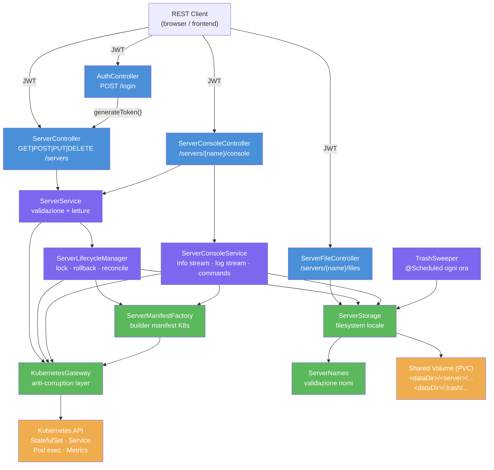
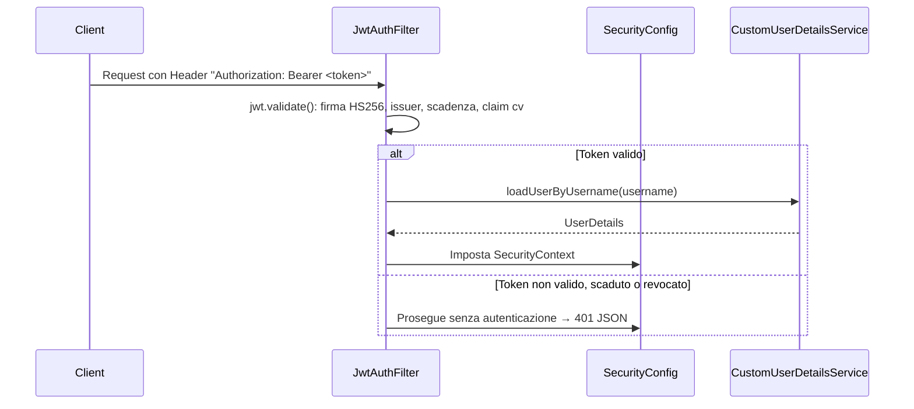
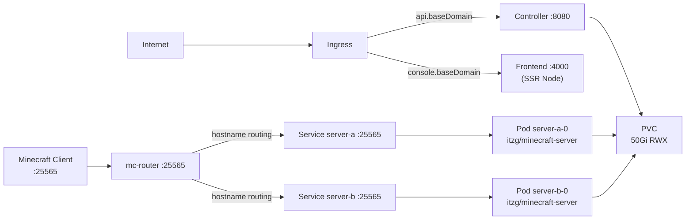

# Architettura

## Panoramica

Minecraft Controller è un'API REST Spring Boot che gestisce server Minecraft come **StatefulSet Kubernetes**. Non usa database: la configurazione di ogni server è serializzata come JSON in un'annotation dello StatefulSet. I file di gioco risiedono su un unico **PersistentVolumeClaim** condiviso (ReadWriteMany), con una sotto-cartella per server.

Ogni server Minecraft è una coppia di risorse Kubernetes:
- **StatefulSet** — controlla il ciclo di vita del pod (`itzg/minecraft-server`)
- **Service** — espone la porta 25565; l'annotation `mc-router.itzg.me/externalServerName` è usata da `itzg/mc-router` per instradare le connessioni Minecraft via hostname

## Diagramma dei Componenti



## Controller REST

| Controller | Base Path | Tag OpenAPI | Responsabilità |
|---|---|---|---|
| `AuthController` | `/login` | AUTH | Autenticazione, emissione JWT |
| `ServerController` | `/servers` | SERVER | CRUD server + start/stop/terminate |
| `ServerConsoleController` | `/servers/{name}/console` | CONSOLE | Info SSE, log SSE, invio comandi |
| `ServerFileController` | `/servers/{name}/files` | FILE SYSTEM | Gestione file sul volume condiviso |
| `IntegrationController` | `/integrations` | INTEGRATIONS | Stato integrazioni, ricerca modpack CurseForge (proxy) |

## Layer di Servizio

### `ServerService`
Regole applicative: validazione (nome DNS-1035, CPU 100–64000m, memoria 512–262144 MB, EULA alla creazione, formato versione, project Modrinth, URL CurseForge + API key configurata), letture (`read`, `list`) e mapping DTO ↔ StatefulSet. Le operazioni multi-step sono delegate a `ServerLifecycleManager`.

### `ServerLifecycleManager`
Coordina le operazioni che toccano sia Kubernetes sia il volume, che non condividono una transazione (vedi [ADR-003](adr/adr-003-lifecycle-compensation.md)):

- **lock per nome server** (`NamedLocks`): due operazioni sullo stesso server non si sovrappongono; server diversi procedono in parallelo;
- **create**: directory → Service → StatefulSet. In caso di errore rollback compensativo: il Service viene rimosso e la directory solo se creata da questa chiamata ed è vuota; nulla viene toccato se esiste uno StatefulSet con quel nome. Un Service orfano lasciato da un create interrotto viene adottato. Se Kubernetes non risponde (esito incerto) lo stato reale viene riletto prima di decidere;
- **update**: read-modify-write con retry su conflitto di `resourceVersion`;
- **delete** idempotente in due fasi: StatefulSet e Service (tollerando "già cancellato"), poi i dati vanno nel cestino solo quando il pod non può più scriverci. Fino ad allora un marker persistito in `<dataDir>/.pending-deletion/` ricorda lo spostamento (sopravvive a un riavvio) e impedisce di ricreare un server con lo stesso nome;
- **reconcile** (`@Scheduled`, default ogni minuto): completa le cancellazioni pendenti, rimuove i Service senza StatefulSet più vecchi del periodo di grazia, aggiorna le metriche per stato;
- metriche `minecraft.controller.operations{operation,outcome}`, `minecraft.controller.servers{state}`, `minecraft.controller.rollback.failures`.

### `ServerConsoleService`
Piano live/streaming. **Info stream**: tutti i viewer di un server condividono un `InfoStream` (un solo polling Kubernetes + exec, sink replay-latest). Il numero di subscriber è gestito esplicitamente dentro `ConcurrentHashMap.compute` (niente race tra creazione, riuso e rimozione); quando l'ultimo viewer si disconnette il polling continua per `console.info-stream-grace-period` (default 10s), poi viene fermato e l'entry rimossa dalla mappa. Se il server viene cancellato lo stream si completa e viene rimosso. **Log stream**: legge `logs/latest.log` dal volume (senza seguire symlink) e invia le nuove righe; righe più lunghe di `console.max-log-line-length` vengono troncate. Entrambi gli stream inviano un commento SSE `:keepalive` come heartbeat. I comandi console sono una sola riga (niente a capo/caratteri di controllo, max 1000 caratteri) e il loro testo non viene loggato.

### `KubernetesGateway`
**Unica classe che comunica con l'API Kubernetes**.

- Timeout di connessione/lettura/scrittura sul client (`kubernetes.*-timeout`).
- **Retry selettivi** (`KubernetesRetry`): solo per chiamate ripetibili (letture, delete, scale) e solo per errori transitori (nessuna risposta/timeout, 429, 500, 502, 503, 504), con backoff esponenziale + jitter e `Retry-After`. Create e replace non vengono mai ripetuti automaticamente: il chiamante verifica lo stato reale.
- Delete idempotenti (`false` se l'oggetto non esisteva).
- **Exec**: un'unica deadline (`kubernetes.exec-timeout`) per lettura di stdout, stderr e attesa del processo; al massimo `kubernetes.exec-max-output-bytes` per stream tenuti in memoria (il resto viene drenato e scartato, `ExecResult.truncated`); in caso di timeout o interruzione i reader vengono cancellati, gli stream chiusi e la connessione distrutta.
- Traduzione degli errori basata su `V1Status.reason`; i messaggi verso il client non contengono il corpo grezzo della risposta (solo loggato):

| Codice HTTP K8s | Eccezione applicativa | HTTP API |
|---|---|---|
| 404 | `ResourceNotFoundException` | 404 |
| 409 reason `AlreadyExists` | `ResourceAlreadyExistsException` | 409 |
| 409 altro (resourceVersion) | `ConflictException` | 409 |
| 400, 422 | `InvalidRequestException` | 400 |
| 401, 403 | `ServerException` (RBAC del controller) | 500 |
| 0 (I/O), 429, 5xx transitori | `KubernetesUnavailableException` | 503 |
| altro | `ServerException` | 500 |

### `ServerManifestFactory`
Costruisce gli oggetti Kubernetes (nessuna chiamata al cluster). Legge/scrive la configurazione JSON nell'annotation `it.lorisdemicheli/config`. Risorse: la memoria scelta è l'heap Java (`MEMORY`); limite memoria = heap + max(heap × `memory-overhead-percent`, `memory-overhead-min-mb`); requests = percentuale dei limiti (`server-resources.*`, default 100% = QoS Guaranteed come prima); limite CPU disattivabile. Pod hardening compatibile con l'immagine itzg: niente token del service account, seccomp `RuntimeDefault`, `privileged: false`, `allowPrivilegeEscalation: false`; modalità `server-security.run-as-non-root` opzionale. La chiave CurseForge è referenziata dal Secret (`secretKeyRef`) quando `curse-forge-api-key-secret.name` è impostato.

### `ServerStorage`
Tutti gli accessi al volume condiviso (vedi [ADR-004](adr/adr-004-secure-directory-stream.md)). Il contenuto delle cartelle dei server è scritto dai processi Minecraft e dai plugin, quindi non è fidato: ogni operazione apre la cartella del server e poi ogni componente del path con `SecureDirectoryStream` e `NOFOLLOW_LINKS` (openat/unlinkat/renameat relativi a un descrittore aperto). Un symlink in qualunque punto del path fa fallire l'operazione anche se compare dopo i controlli (niente TOCTOU); i symlink sono elencati, rinominati e cancellati come link, mai seguiti. Scritture e upload passano da un file temporaneo nella stessa cartella rinominato atomicamente sul target (permessi preservati), quindi il server Minecraft non legge mai file scritti a metà; un upload fallito non lascia residui. Il disk usage segnala le voci illeggibili (`partial`) invece di restituire un valore apparentemente preciso.

Layout volume:
```
<dataDir>/
├── <server-a>/                 ← montato nel pod come subPath=server-a
│   ├── logs/latest.log
│   └── ...
├── .trash/
│   └── <server-a>-<millis>/    ← soft-delete, purgato da TrashSweeper
└── .pending-deletion/
    └── <server-b>              ← cancellazione in attesa che il pod si fermi
```

### `TrashSweeper`
Componente schedulato: 60 secondi dopo il boot, poi ogni ora, purga le cartelle in `.trash` più vecchie di `storage.trash-retention-hours`. Con retention `0` non cancella mai nulla. Le voci non create dal controller vengono ignorate.

### `CurseForgeClient` / `IntegrationController`
Proxy della ricerca modpack CurseForge (`GET /integrations/curseforge/modpacks?query=`) e stato delle integrazioni (`GET /integrations`): la API key resta sul server invece di essere compilata nel bundle della console.

## Errori

Tutte le risposte di errore hanno lo stesso formato JSON (`ApiErrors`):

```json
{"timestamp": "2026-01-01T10:00:00Z", "status": 409, "error": "Conflict", "message": "Server alpha already exists"}
```

| HTTP | Quando |
|---|---|
| 400 | `InvalidRequestException`, parametri mancanti o malformati |
| 401 | token assente/scaduto/revocato (`message` lo distingue), credenziali errate |
| 403 | accesso negato |
| 404 | risorsa inesistente |
| 409 | conflitto con lo stato (server esistente, in cancellazione, spazio insufficiente, modifica concorrente) |
| 413 | upload oltre `spring.servlet.multipart.max-file-size` |
| 429 | troppi login falliti (header `Retry-After`) |
| 500 | `ServerException` (messaggio pensato per il client) o errore imprevisto (messaggio generico + `errorId` presente anche nel log) |
| 503 | API Kubernetes non disponibile |

Le risposte non contengono mai stack trace, corpi di risposta Kubernetes o path del filesystem esterni al server. Anche gli endpoint SSE rispondono con JSON in caso di errore prima dell'apertura dello stream.

## Sicurezza



- Sessioni: `STATELESS` (no HttpSession), nessun cookie (CSRF non applicabile, CORS senza credenziali).
- Password admin: BCrypt-encoded a startup da `CustomUserDetailsService`.
- Token: issuer `minecraft-controller`, clock skew 30s, claim `cv` = HMAC di username+password: una rotazione delle credenziali revoca i token emessi prima ([ADR-002](adr/adr-002-stateless-single-admin.md)).
- Login: max `security.login-max-attempts` fallimenti per client in `security.login-window` (poi 429). Con l'Ingress l'indirizzo del client è letto da `X-Forwarded-For` solo se la richiesta arriva da una rete privata (`server.forward-headers-strategy=native`).
- Path pubblici: `/login`, `/swagger-ui/**`, `/v3/api-docs/**`, `/actuator/health/**`, `/actuator/prometheus`. Actuator è servito solo sulla porta di management (8081), non esposta dall'Ingress.
- Password, JWT secret, token e testo dei comandi console non vengono mai loggati né restituiti.
- `JwtAuthFilter.shouldNotFilterAsyncDispatch()` restituisce `false` → il filtro viene eseguito anche per i dispatch asincroni (necessario per SSE).

## Osservabilità

- Log: testo di default, JSON (Elastic Common Schema) con `LOGGING_STRUCTURED_FORMAT_CONSOLE=ecs` (`controller.logFormat=json` nel chart). Eventi registrati: creazione/aggiornamento/cancellazione/start/stop/terminate (con `server=`), rollback, operazioni sui file (solo path), upload (dimensione), comandi console (solo lunghezza), login riusciti/falliti/limitati, errori Kubernetes (codice, reason).
- Health (porta 8081): `/actuator/health/liveness` (solo stato interno: un disservizio dell'API Kubernetes non provoca riavvii), `/actuator/health/readiness` (+ volume dati montato e scrivibile, `DataVolumeHealthIndicator`).
- Metriche (`/actuator/prometheus`, nessun dato sensibile): `minecraft_controller_servers{state}`, `minecraft_controller_operations_seconds{operation,outcome}`, `minecraft_controller_kubernetes_errors_total{code}`, `minecraft_controller_rollback_failures_total`, `minecraft_controller_pending_deletions`, `minecraft_controller_sse_info_streams`, `minecraft_controller_sse_info_subscribers`, `minecraft_controller_sse_log_streams`, `minecraft_controller_console_poll_errors_total`, oltre a JVM/HTTP standard. Nessun sistema di monitoring è richiesto.

## Moduli Maven e Dipendenze Chiave

Il progetto ha un solo modulo Maven: `backend/`.

```xml
<!-- Dipendenze principali -->
io.kubernetes:client-java:24.0.0        <!-- client puro: la spring-integration non era usata e rompeva l'avvio -->
org.springframework.boot:spring-boot-starter-web
org.springframework.boot:spring-boot-starter-security
org.springframework.boot:spring-boot-starter-actuator
io.micrometer:micrometer-registry-prometheus
io.projectreactor:reactor-core          <!-- solo per SSE -->
io.jsonwebtoken:jjwt-api:0.11.5
org.springdoc:springdoc-openapi-starter-webmvc-ui:3.0.0
org.projectlombok:lombok
<!-- test -->
spring-boot-starter-test, spring-security-test, reactor-test
```

> **Nota di build**: Lombok deve essere elencato in `<annotationProcessorPaths>` del `maven-compiler-plugin`. Se presente solo in `<dependencies>`, il processor viene escluso quando `<annotationProcessorPaths>` è configurato esplicitamente.

## Configurazione

Tutti i parametri applicativi sono in `MinecraftServerOptions` (prefisso `it.lorisdemicheli.minecraft-servers`), validati all'avvio: un valore errato blocca l'avvio con l'elenco di tutti i problemi. Come variabile d'ambiente: `IT_LORISDEMICHELI_MINECRAFTSERVERS_<PERCORSO>` (es. `..._KUBERNETES_EXECTIMEOUT=30s`).

| Proprietà (`it.lorisdemicheli.minecraft-servers.`) | Default | Note |
|---|---|---|
| `namespace` | `minecraft-servers` | namespace dei server (= quello del PVC) |
| `base-domain` | — | **obbligatorio** |
| `server-image` | `itzg/minecraft-server` | |
| `termination-grace-period-seconds` | `120` | |
| `cors-allowed-origins` | `http://localhost:4200` | |
| `curse-forge-api-key` | — | solo per CURSEFORGE |
| `curse-forge-api-key-secret.name` / `.key` | — / `curseforge-api-key` | Secret letto dai pod dei server |
| `curse-forge-api-url` | `https://api.curseforge.com` | |
| `security.username` | `admin` | |
| `security.password` | — | **obbligatorio** |
| `security.jwt-secret` | — | **obbligatorio**, ≥ 32 byte |
| `security.jwt-expiration-ms` | `86400000` | 1 min – 30 giorni |
| `security.login-max-attempts` / `login-window` | `10` / `5m` | |
| `storage.data-dir` | `./data` | |
| `storage.claim-name` | `minecraft-servers-data` | |
| `storage.uid` / `gid` | `1000` | |
| `storage.trash-retention-hours` | `24` | `0` = nessuna purga |
| `storage.min-free-gb` | `2` | create e upload |
| `kubernetes.connect-timeout` / `read-timeout` / `write-timeout` | `10s` / `30s` / `30s` | |
| `kubernetes.exec-timeout` | `20s` | deadline totale di un exec |
| `kubernetes.exec-max-output-bytes` | `1048576` | per stream |
| `kubernetes.retry-max-attempts` | `4` | tentativi totali (1–10) |
| `kubernetes.retry-initial-backoff` / `retry-max-backoff` | `200ms` / `5s` | |
| `console.info-poll-interval` | `10s` | |
| `console.info-stream-grace-period` | `10s` | |
| `console.log-poll-interval` | `500ms` | |
| `console.heartbeat-interval` | `15s` | |
| `console.max-log-line-length` | `8192` | |
| `server-resources.cpu-request-percent` | `100` | |
| `server-resources.cpu-limit-enabled` | `true` | |
| `server-resources.memory-request-percent` | `100` | |
| `server-resources.memory-overhead-percent` / `memory-overhead-min-mb` | `15` / `256` | |
| `server-security.run-as-non-root` | `false` | |
| `lifecycle.reconcile-interval` | `1m` | |
| `lifecycle.orphan-grace-period` | `10m` | |

Altre proprietà: `kubernetes.client.file` (kubeconfig per lo sviluppo locale; in cluster si usa il service account), `management.server.port` (`8081`), `spring.servlet.multipart.max-file-size` (`1GB`).

## Infrastruttura Kubernetes (Helm)

Il chart `charts/minecraft-controller/` crea:
- `Deployment` per il controller (Spring Boot, porta 8080, management 8081, strategia `Recreate`, una sola replica)
- `Deployment` per mc-router (`itzg/mc-router`, porta 25565)
- `Deployment` per il frontend Angular (SSR su Node, porta 4000, attivo di default; riceve `API_BASE_URL` e `NG_ALLOWED_HOSTS` all'avvio)
- `PersistentVolumeClaim` condiviso (default: StorageClass del cluster, RWX, 50Gi)
- `Secret` con credenziali (generato o da `existingSecret`)
- `Ingress` per API (`api.<baseDomain>`) e console (`console.<baseDomain>`)
- `ServiceAccount` e `RBAC` (Role, RoleBinding per controller e router, nessun ClusterRole)
- opzionali: `NetworkPolicy`, HPA e PDB del router, `CronJob` di backup, `helm test`

Dettagli e parametri: [charts/minecraft-controller/README.md](../charts/minecraft-controller/README.md).


