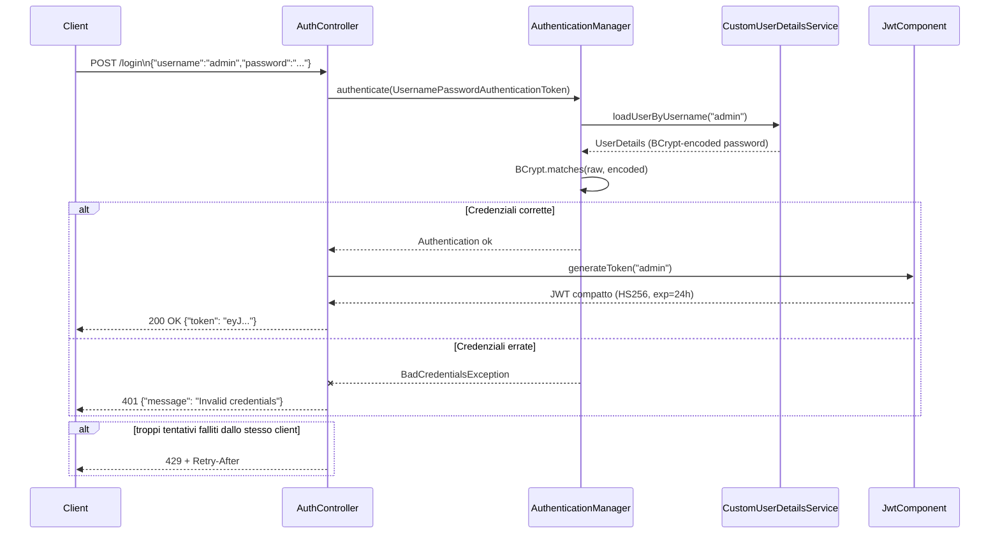
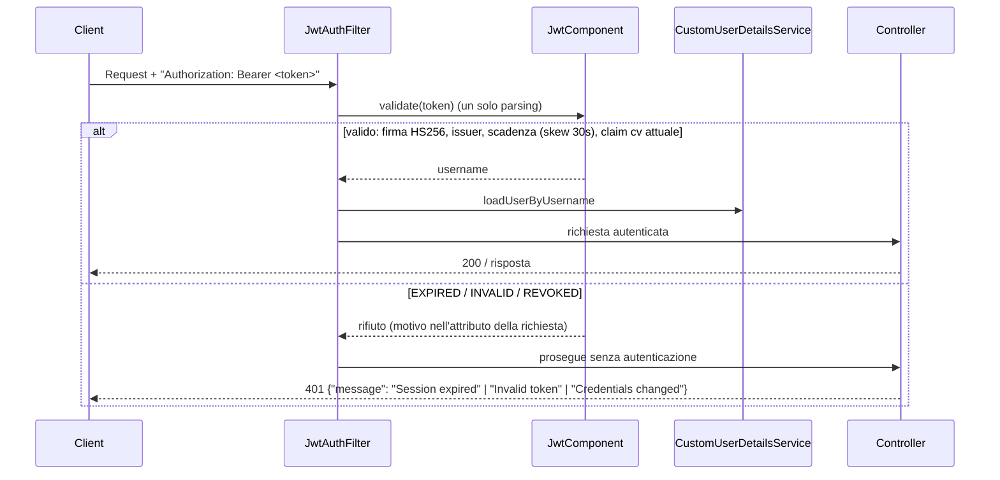

# Flusso: Autenticazione JWT

## Descrizione

Il controller usa autenticazione **JWT stateless** con un singolo account admin. Non esiste gestione multi-utente né sessione server-side.

## Endpoint

| Metodo | Path | Auth richiesta |
|---|---|---|
| `POST` | `/login` | No (path pubblico) |

Tutti gli altri endpoint richiedono il token JWT nell'header `Authorization: Bearer <token>`.

---

## Diagramma di Sequenza — Login

## Diagramma di Sequenza — Richiesta Autenticata

---

## Classi Coinvolte

| Classe | Ruolo |
|---|---|
| `AuthController` | `POST /login`; throttling, log dei tentativi (mai la password) |
| `LoginAttemptLimiter` | max `security.login-max-attempts` fallimenti per client in `security.login-window` → 429 |
| `JwtComponent` | Genera e valida i JWT (HS256, issuer `minecraft-controller`, claim `cv`) |
| `CustomUserDetailsService` | Carica l'unico account admin (password BCrypt-encoded a startup) |
| `JwtAuthFilter` | `OncePerRequestFilter`: valida il token e imposta il `SecurityContext` |
| `SecurityConfig` | STATELESS, no CSRF, percorsi pubblici, entry point 401 JSON, access denied 403 JSON, CORS |

---

## Dettagli Implementativi

### JwtComponent
- Chiave HMAC-SHA256 da `security.jwt-secret` (obbligatoria, ≥ 32 byte; verificata all'avvio da `MinecraftServerOptions`).
- Scadenza `security.jwt-expiration-ms` (default 24h, consentito 1 minuto – 30 giorni).
- Claim: `iss`, `sub`, `jti`, `iat`, `exp`, `cv`. Vengono rifiutati token non firmati, firmati con altra chiave o altro algoritmo, con issuer diverso, malformati o più lunghi di 4 KB.
- **Revoca senza database**: `cv` = HMAC(jwt-secret, username + password). Cambiando password o username (e riavviando il controller) i token precedenti diventano `REVOKED`; cambiando il jwt-secret diventano `INVALID`. Vedi [ADR-002](../adr/adr-002-stateless-single-admin.md).
- Nei log compare solo il motivo del rifiuto, mai il token.

### Login
- Indirizzo del client: `request.getRemoteAddr()`; dietro l'Ingress viene da `X-Forwarded-For` solo se la richiesta arriva da reti private (`server.forward-headers-strategy=native`).
- Un login riuscito azzera il contatore del client. Lo stato è in memoria (una replica) e si perde al riavvio.

### JwtAuthFilter
- `shouldNotFilterAsyncDispatch()` restituisce `false`: il filtro viene eseguito anche per i dispatch asincroni (SSE).
- `UsernameNotFoundException` (username cambiato): richiesta non autenticata → 401 "Credentials changed".

### Frontend
- `Auth` legge la scadenza (`exp`) dal token, lo scarta se scaduto e programma il logout alla scadenza.
- `errorInterceptor`: un 401 dall'API chiude la sessione e torna al login (con `returnUrl`); il token viene aggiunto solo alle richieste verso l'API (mai a Modrinth/CurseForge).

---

## Edge Case

| Scenario | Comportamento |
|---|---|
| Nessun token | 401 "Authentication required" (prima: 403) |
| Token scaduto | 401 "Session expired: log in again" |
| Token con firma non valida, non firmato, issuer diverso | 401 "Invalid token" |
| Password cambiata dopo l'emissione | 401 "Credentials changed: log in again" |
| Password errata | 401 "Invalid credentials" |
| Troppi tentativi | 429 + `Retry-After` |
| Richiesta a `/swagger-ui/**` senza token | Sempre permessa (path pubblico) |
| `jwt-secret` < 32 byte o password mancante | l'applicazione non parte, il messaggio elenca le proprietà errate |
