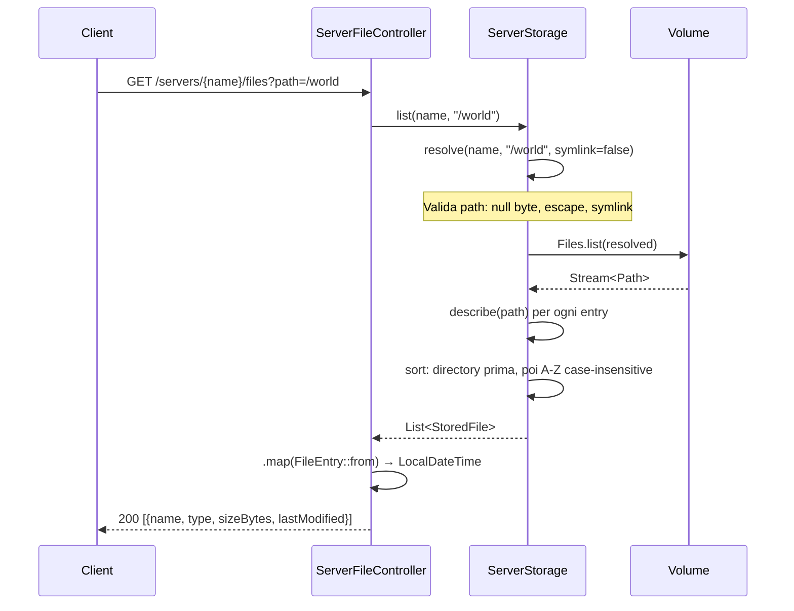
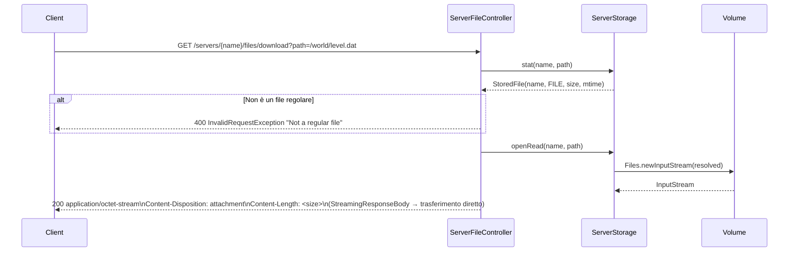
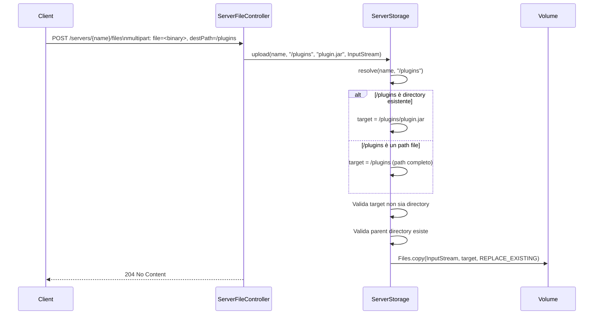
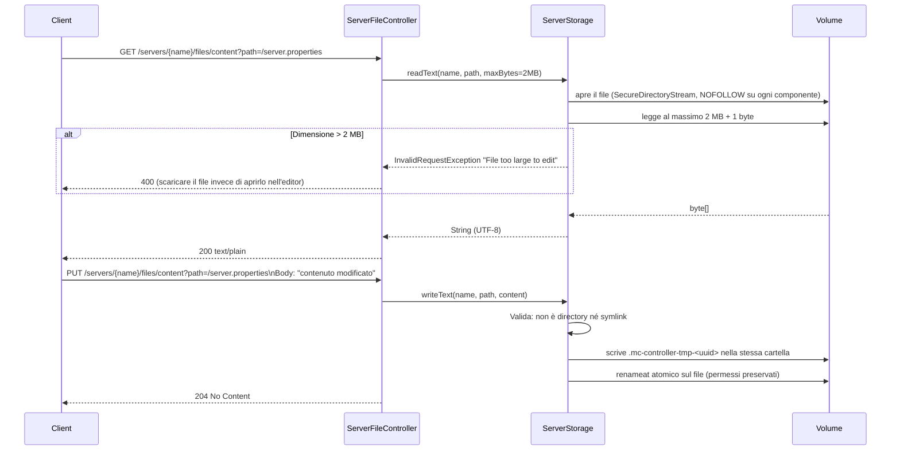
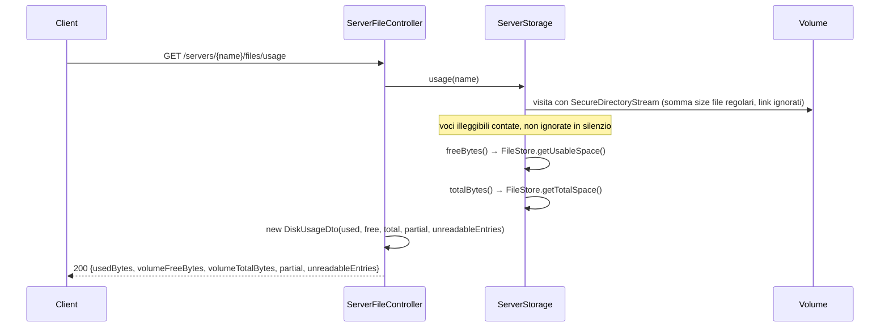

# Flusso: Gestione File

## Descrizione

API di file manager per la cartella dati di un server. Tutte le operazioni accedono direttamente al volume condiviso tramite `ServerStorage`, indipendentemente dallo stato del server (funziona anche con il server fermo).

La sicurezza è gestita da `ServerStorage.resolve()`: ogni path viene validato per evitare directory traversal (`..`) e symlink escape.

## Endpoint

| Metodo | Path | Query params | Descrizione |
|---|---|---|---|
| `GET` | `/servers/{name}/files` | `path=/` | Lista directory |
| `GET` | `/servers/{name}/files/download` | `path=<file>` | Download file (streaming) |
| `POST` | `/servers/{name}/files` | `destPath=<dir>`, `file=<multipart>` | Upload file (max 1 GB) |
| `POST` | `/servers/{name}/files/directory` | `path=<dir>` | Crea directory |
| `POST` | `/servers/{name}/files/touch` | `path=<file>` | Crea file vuoto / aggiorna mtime |
| `DELETE` | `/servers/{name}/files` | `path=<path>` | Elimina file o directory |
| `GET` | `/servers/{name}/files/content` | `path=<file>` | Leggi testo (max 2 MB) |
| `PUT` | `/servers/{name}/files/content` | `path=<file>` | Scrivi testo |
| `POST` | `/servers/{name}/files/rename` | `path=<path>`, `newName=<name>` | Rinomina |
| `POST` | `/servers/{name}/files/copy` | `sourcePath=<path>`, `destPath=<path>` | Copia |
| `GET` | `/servers/{name}/files/usage` | — | Spazio disco usato / disponibile |

---

## Layout Volume

```
<dataDir>/
└── <server-name>/          ← root del server (IRRIMUOVIBILE via API)
    ├── logs/
    │   └── latest.log      ← letto anche da ServerConsoleService
    ├── world/
    ├── server.properties
    └── ...
```

---

## Diagramma: Lista e Navigazione



---

## Diagramma: Download File



**Nota**: `StreamingResponseBody` evita buffering in memoria: adatto per file di qualsiasi dimensione.

---

## Diagramma: Upload File



**Limite**: `spring.servlet.multipart.max-file-size=1GB` (configurato in `application.properties`). File più grandi ricevono 413.

---

## Diagramma: Lettura / Scrittura Testo



---

## Regole di Sicurezza e Validazione

Vedi [ADR-004](../adr/adr-004-secure-directory-stream.md). Il contenuto delle cartelle dei server è scritto da Minecraft e dai plugin: è considerato non fidato e può cambiare in qualunque momento.

1. **Parsing lessicale** (`RelPath`): `\` trattato come separatore, componenti vuoti e `.` ignorati, `..` rimuove il componente precedente e non può risalire oltre la cartella del server (`InvalidRequestException "Path escapes the server directory"`); `\0` e nomi > 255 byte rifiutati. Un path assoluto (`/a/b`) è relativo alla cartella del server.
2. **Nessun path risolto dal sistema operativo**: la cartella del server viene aperta dalla radice del volume con `NOFOLLOW_LINKS`, poi ogni componente con `SecureDirectoryStream.newDirectoryStream(name, NOFOLLOW_LINKS)`; file aperti, cancellati e rinominati relativamente al descrittore della cartella (`openat`, `unlinkat`, `renameat`). Un symlink **in qualunque posizione** fa fallire l'operazione con 400, anche se è stato creato dopo i controlli (TOCTOU).
3. **Symlink**: elencati come `OTHER`, si possono rinominare e cancellare (si rimuove il link, mai il target); non vengono mai letti, scritti, attraversati o copiati (la copia di una cartella li salta).
4. **Scritture atomiche**: `writeText` e `upload` scrivono un file temporaneo nella stessa cartella e lo rinominano sul target; un errore a metà non lascia file parziali né temporanei, la versione precedente resta intatta.
5. **Upload**: streaming verso disco (mai l'intero file in memoria), nome ridotto all'ultimo componente e validato (no `.`, `..`, caratteri di controllo); rifiutato se lascerebbe meno di `storage.min-free-gb` liberi.
6. **Root directory**: cancellazione e rinomina della root del server sono rifiutate.
7. **Rename**: nessun separatore nel nuovo nome; target esistente → 409.
8. **Copy directory-in-itself** rilevata e rifiutata; una copia fallita viene rimossa.
9. **Concorrenza**: scritture concorrenti sullo stesso file producono sempre uno dei contenuti completi (l'ultimo rename vince); una cartella che cambia durante una cancellazione viene ritentata, poi 409.
10. **Limite noto**: Java non espone `mkdirat`, quindi la *creazione* di directory usa il path (subito dopo aver aperto i genitori senza seguire link) e la directory creata viene riaperta con NOFOLLOW. In una race estrema si potrebbe creare una directory vuota fuori posto, mai leggere o scrivere file.

---

## Spazio Disco (`GET /files/usage`)



Con `partial=true` il valore `usedBytes` è un limite inferiore (e un warning viene loggato).

---

## Gestione Eccezioni

| Eccezione | HTTP | Causa |
|---|---|---|
| `ResourceNotFoundException` | 404 | Directory/file non trovato, parent non trovato |
| `InvalidRequestException` | 400 | Path non valido, non è file regolare, file troppo grande, nome con separator |
| `ConflictException` | 409 | Directory già esiste (mkdir), file già esiste (rename/copy), spazio insufficiente (upload), permesso negato dal filesystem |
| `MaxUploadSizeExceededException` | 413 | File upload > 1 GB |
