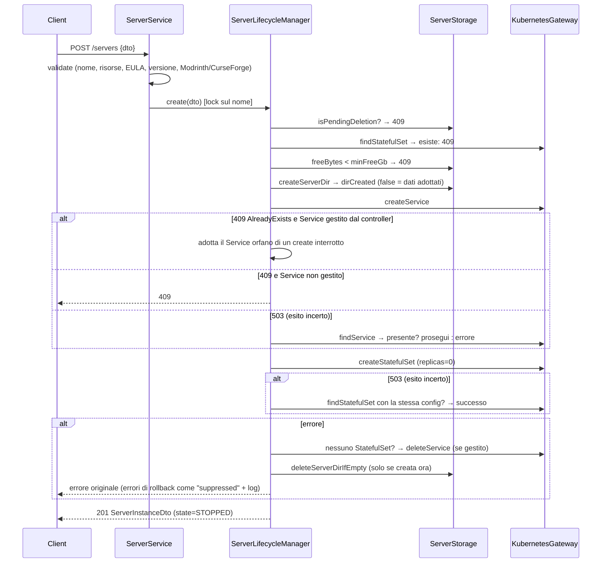
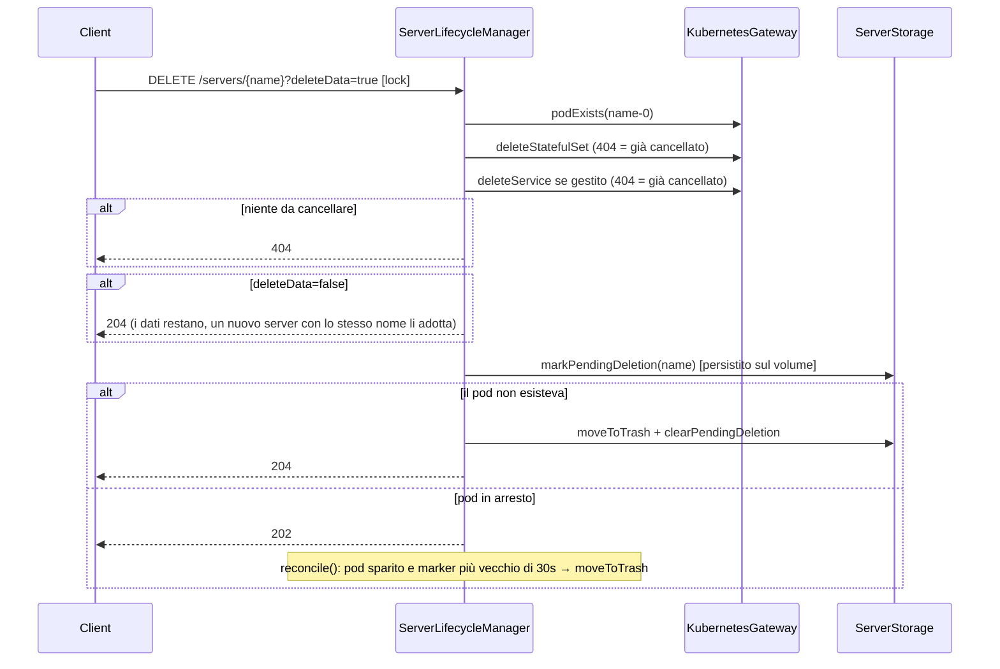

# Flusso: Ciclo di Vita dei Server

## Descrizione

Gestione completa di un server Minecraft: creazione, lettura, aggiornamento, eliminazione, avvio, stop e terminazione immediata. Ogni server corrisponde a una coppia di risorse Kubernetes (StatefulSet + Service) e a una cartella sul volume condiviso.

`ServerService` valida e converte i DTO; `ServerLifecycleManager` esegue le operazioni multi-step con lock per nome, compensazione e recupero (vedi [ADR-003](../adr/adr-003-lifecycle-compensation.md)).

## Endpoint

| Metodo | Path | Operazione | Risposta |
|---|---|---|---|
| `GET` | `/servers` | Lista tutti i server | 200 |
| `GET` | `/servers/{name}` | Leggi un server | 200 |
| `POST` | `/servers` | Crea un server | 201 + `Location` |
| `PUT` | `/servers/{name}` | Aggiorna un server (un server acceso si riavvia) | 200 |
| `DELETE` | `/servers/{name}?deleteData=true` | Elimina un server | 204, oppure **202** se i file andranno nel cestino appena il pod si sarà fermato |
| `POST` | `/servers/{name}/console/start` | Avvia (replicas → 1) | 204 |
| `POST` | `/servers/{name}/console/stop` | Stop graceful (replicas → 0) | 204 |
| `POST` | `/servers/{name}/console/terminate` | Kill immediato | 204 |

---

## Creazione



Garanzie:
- non vengono mai cancellati dati o risorse di un server esistente: il rollback non fa nulla se esiste uno StatefulSet con quel nome, e la cartella viene rimossa solo se creata da questa chiamata **e** vuota;
- se il rollback stesso fallisce (API giù) la cartella viene lasciata e il Service orfano verrà rimosso dalla riconciliazione;
- ripetere il create dopo un'interruzione funziona: Service orfano adottato, cartella riusata.

## Aggiornamento

`PUT /servers/{name}`: il nome viene dal path. Read-modify-write dello StatefulSet (annotation di config, env, risorse, security context); in caso di conflitto di `resourceVersion` (modifica concorrente) rilettura e nuovo tentativo, fino a 3 volte. Se l'API non risponde, lo stato viene riletto: se la config è già quella richiesta l'aggiornamento è considerato riuscito.

## Eliminazione



- Ogni passo è idempotente: se la cancellazione del Service fallisce, la stessa richiesta ripetuta completa il lavoro; i dati non vengono toccati finché StatefulSet e Service non sono stati rimossi.
- I dati vanno nel cestino solo quando nessun pod può più scriverci (un pod cancellato forzatamente sparisce dall'API prima che il container sia davvero fermo: per questo il ritardo di sicurezza).
- Finché la cancellazione è pendente non si può creare né avviare un server con lo stesso nome (409).
- Se nel frattempo lo StatefulSet ricompare (creato a mano), il marker viene annullato e i dati restano al server.
- Il cestino è svuotato da `TrashSweeper` dopo `storage.trash-retention-hours` (0 = mai).

## Start / Stop / Terminate

| Operazione | Azione |
|---|---|
| start | 404 se lo StatefulSet non esiste; 409 se in cancellazione; ricrea la cartella se manca (altrimenti kubelet la creerebbe di root); `replicas=1` |
| stop | `replicas=0`: il server ha `termination-grace-period-seconds` per salvare il mondo |
| terminate | `replicas=0` + cancellazione del pod con grace 0 (pod già assente: ok) |

Tutte e tre sono idempotenti e ritentate dal gateway in caso di errori transitori.

## Riconciliazione

`ServerLifecycleManager.reconcile()` (ogni `lifecycle.reconcile-interval`, default 1 minuto):
1. completa le cancellazioni pendenti (vedi sopra);
2. rimuove i Service con label `managed-by=minecraft-controller` senza StatefulSet, più vecchi di `lifecycle.orphan-grace-period` (default 10 minuti, così un create in corso non viene mai toccato);
3. aggiorna la metrica `minecraft_controller_servers{state}`.

Gli errori (es. API giù) vengono loggati e la riconciliazione riprova al giro successivo.

## Stato

Derivato dallo StatefulSet (`ServerStates`), senza lookup del pod:

```
spec.replicas=0, status.replicas=0  → STOPPED
spec.replicas=0, status.replicas>0  → SHUTDOWN (terminando)
spec.replicas=1, readyReplicas=0    → STARTING
spec.replicas=1, readyReplicas≥1    → RUNNING
```

`GET /servers` ignora (con un warning nel log) gli StatefulSet senza annotation di configurazione valida.

## Errori

| Caso | HTTP |
|---|---|
| nome non valido, risorse fuori range, EULA non accettata, versione/modpack non validi | 400 |
| server inesistente | 404 |
| nome riservato o già usato, cancellazione pendente, spazio insufficiente, Service non gestito con lo stesso nome, CurseForge non configurato, modifica concorrente persistente | 409 |
| API Kubernetes non disponibile dopo i retry | 503 |
